# Architecture and ownership

## Public capability ownership

A caller or agent enters through the `Application` facade. The facade coordinates focused application services rather
than owning a second model: discovery derives contracts from registered diagram features, commands mutate typed diagram
state, persistence encodes and hydrates that state, and the Mermaid boundary reads valid state for source generation and
full rendering validation.

[View the generated Mermaid source](public-capability-flow.mmd).

<!-- enclosure-diagram: Wnr7HPDou8Hureu5xo3NYk revision: 1 -->

## Entry points and lifetimes

Public callers enter through [`Application`](../../src/mermaiden/application.py). Command-line compatibility checks
enter through [`mermaiden.cli`](../../src/mermaiden/cli.py). Both use the cached process scope created by
[`bootstrap.process_scope()`](../../src/mermaiden/bootstrap.py). An `Application` is a lightweight handle: closing it
invalidates that handle, while the shared dependency scope remains process-owned. Diagram models are transient; scoped
services share that process scope.

## Layers and dependencies

- `src/mermaiden/core` owns diagram values, validation reports, character policies, and neutral naming.
- `src/mermaiden/runtime` owns generic aggregate state, structural constraints, transactions, and snapshot
  encoding. It depends on core, not on a concrete diagram feature.
- `src/mermaiden/diagrams` owns the concrete syntax features and the catalog assembled from their explicit
  descriptors. Concrete feature packages are independent and may share diagram concepts only through `diagrams.shared`.
- `src/mermaiden/mutations` validates and dispatches public command payloads against the catalog.
- `src/mermaiden/mermaid` owns Mermaid configuration compatibility, Jinja templates, source rendering,
  previews, and optional `mmdc` validation.
- [`application.py`](../../src/mermaiden/application.py) is the public facade;
  [`bootstrap.py`](../../src/mermaiden/bootstrap.py) is the only composition root. The
  [import-linter contract](../../.importlinter) enforces feature independence.

## Single sources of truth

Supported diagrams and commands
: Each concrete model's `DiagramDefinition` and `DiagramFeature` owns its objects, configuration type, commands, and
  snapshot properties. [`DiagramsApplication`](../../src/mermaiden/diagrams/application.py) is the runtime registry;
  [`DiagramCatalog`](../../src/mermaiden/diagrams/catalog/service.py) derives discovery schemas from it.

Mermaid version and upstream configuration schema
: [`schema.lock.json`](../../src/mermaiden/mermaid/compatibility/schema.lock.json) pins the version, source URL, and
  checksum. [`config.schema.json`](../../src/mermaiden/mermaid/compatibility/schemas/config.schema.json) is the checked
  content, and
  [`configuration_overrides.json`](../../src/mermaiden/mermaid/compatibility/configuration_overrides.json) records
  reviewed differences.

Feature configuration
: The configuration class named by each `DiagramFeature`; compatibility is checked against the locked upstream schema.

Snapshot envelope and type identities
: `SNAPSHOT_VERSION` in [`runtime/snapshot/domain.py`](../../src/mermaiden/runtime/snapshot/domain.py), the matching
  [`schema.v7.json`](../../src/mermaiden/runtime/snapshot/schema.v7.json), and registry-derived discriminators in
  [`DiagramSnapshotRegistry`](../../src/mermaiden/diagrams/services/snapshot_registry.py).

Dependency composition and lifetime
: [`bootstrap.py`](../../src/mermaiden/bootstrap.py).

Compatibility fixtures
: [`FixtureCatalog`](../../tests/fixtures/catalog.py) combines test-owned fixture builders and requires one populated
  fixture for every runtime-registered syntax.

Mermaid templates
: `src/mermaiden/mermaid/templates/syntax`, checked against the runtime catalog by
  [`MermaidTemplateOwnership`](../../src/mermaiden/mermaid/templates/ownership.py).

Shared primitives
: [`ClassName`](../../src/mermaiden/core/naming.py) owns class naming, and
  [`Direction`](../../src/mermaiden/diagrams/shared/direction.py) owns shared diagram direction. Feature-specific flow
  types remain in their features.

Python and Mermaid tool dependencies
: Runtime and development declarations live in [`pyproject.toml`](../../pyproject.toml). [`uv.lock`](../../uv.lock)
  fixes Python resolution, and [`package-lock.json`](../../package-lock.json) fixes the Mermaid CLI.

Generated mutation documentation
: [`contract.json`](../contracts/diagram-mutations/contract.json) and its matrices, regenerated only with
  [`make mutation-contract`](../../Makefile) through
  [`render_mutation_contract.py`](../../scripts/render_mutation_contract.py).

## I/O boundaries

The package reads its checked-in Mermaid schema and templates while rendering or checking compatibility. Persistent
output is written only through caller-requested preview operations. `Application.validate_render()` owns its temporary
files and is the external-process boundary that invokes the locked Mermaid CLI. Ordinary source generation does not
invoke a browser, npm, or Mermaid executable.
